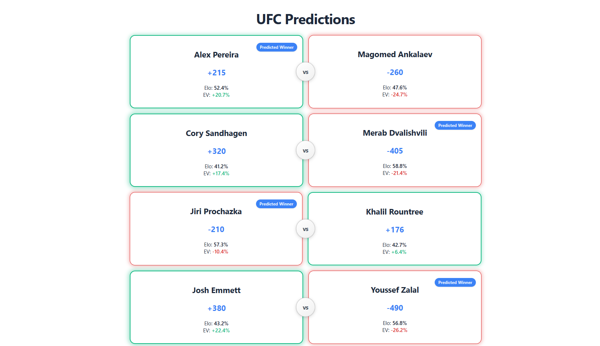

# FightEV — UFC Predictions

A clean React + TypeScript web app displaying upcoming UFC fight cards with live sportsbook odds alongside a CPU-only Elo-plus-logistic win-probability and expected-value model. Positive-EV picks are highlighted in green with suggested Kelly unit sizing. The fight card and persisted predictor are refreshed automatically each week.

If you use this to place your own bets, please do so at your own discretion.

<p align="center">
  
</p>

## Features

- **Live Odds & Implied Probabilities** from The Odds API
- **CPU-Only Elo + Logistic Model** using Elo as the primary signal and logistic regression for feature-based adjustment
- **Matchup-Aware Method Predictions** combining the predicted winner's winning methods with the opponent's losing methods
- **Expected Value (+EV) Calculation** & highlighted edge cards
- **Quarter-Kelly Criterion** suggested bet unit sizing (`0.5u` – `3.0u`)
- **Interactive Fight History Popups** showing a fighter's last 5 UFC bouts
- **Fighters Directory & Profiles** with active-fighter search and result/finish timelines
- **Automated Workflows** on GitHub Actions to refresh cards and update historical fights weekly

## Tech Stack

- **Frontend:** React, TypeScript, Vite, Framer Motion, Recharts
- **Backend:** Python, FastAPI, SQLite, SQLAlchemy, scikit-learn
- **Data & Automation:** Beautiful Soup, The Odds API, GitHub Actions

## Getting Started

```bash
docker compose up --build
```
