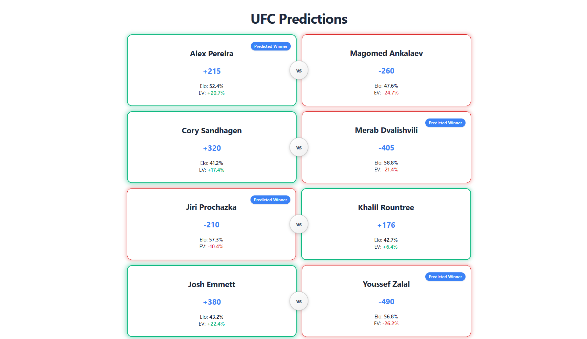

# FightEV — UFC Predictions

A clean React + TypeScript web app displaying upcoming UFC fight cards with live sportsbook odds alongside a CPU-only scikit-learn ensemble win-probability and expected-value model. Positive-EV picks are highlighted in green with suggested Kelly unit sizing. The fight card is refreshed automatically on fight weekends, and completed results are used to retrain the ensemble on API startup.

If you use this to place your own bets, please do so at your own discretion.

<p align="center">
  
</p>

## Features

- **Live Odds & Implied Probabilities** from The Odds API
- **CPU-Only Ensemble Model** combining logistic regression, random forest, and histogram gradient boosting
- **Matchup-Aware Method Predictions** combining the predicted winner's winning methods with the opponent's losing methods
- **Expected Value (+EV) Calculation** & highlighted edge cards
- **Quarter-Kelly Criterion** suggested bet unit sizing (`0.5u` – `3.0u`)
- **Interactive Fight History Popups** showing a fighter's last 5 UFC bouts
- **Fighters Directory & Profiles** with weight class division filters and model score history
- **Automated Workflows** on GitHub Actions to refresh cards and update historical fights weekly

## Tech Stack

- **Frontend:** React, TypeScript, Vite, Framer Motion, Recharts
- **Backend:** Python, FastAPI, SQLite, SQLAlchemy, scikit-learn
- **Data & Automation:** Beautiful Soup, The Odds API, GitHub Actions

## Getting Started

```bash
docker compose up --build
```
